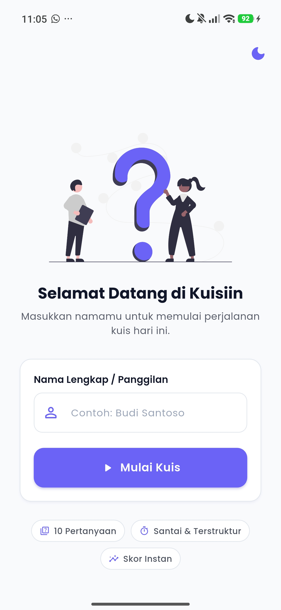
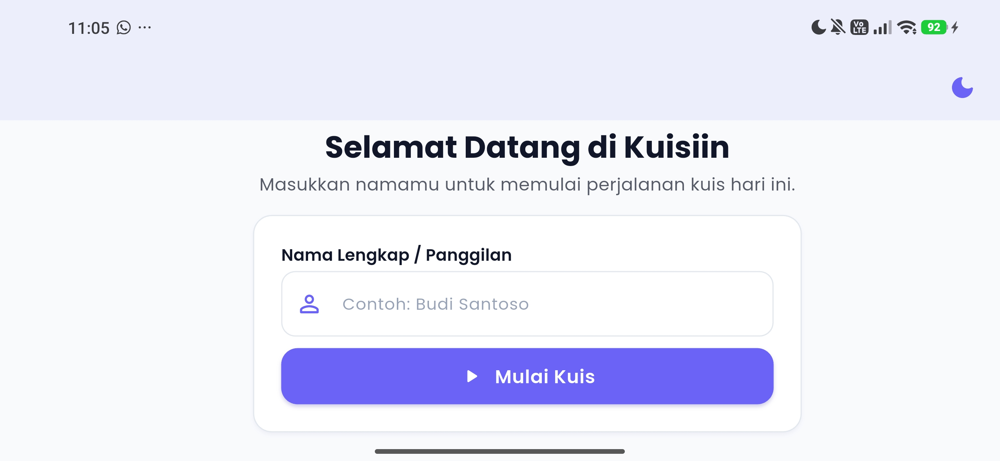
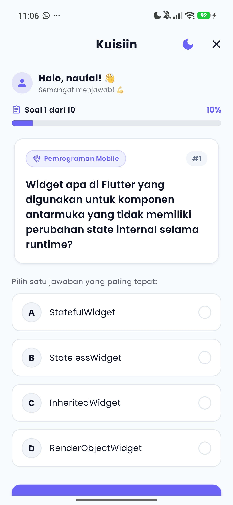
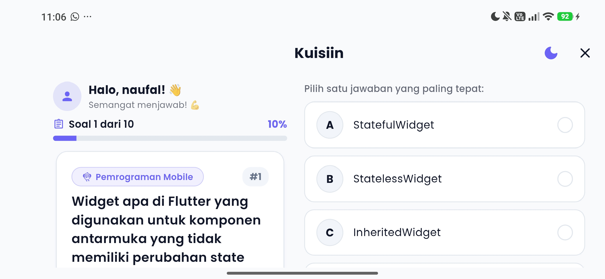
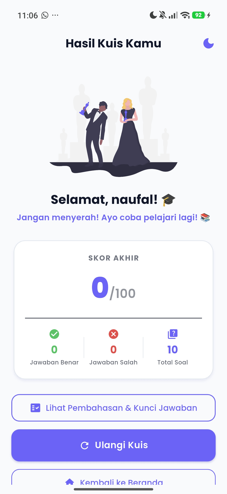
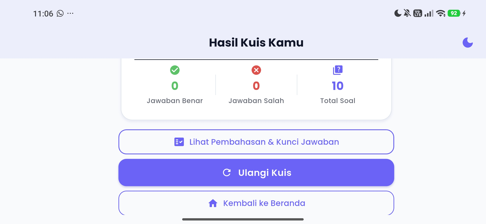
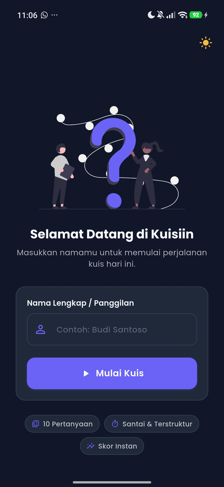
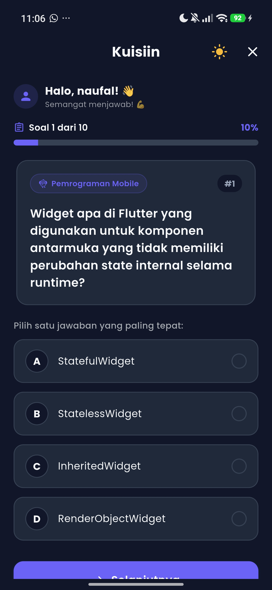
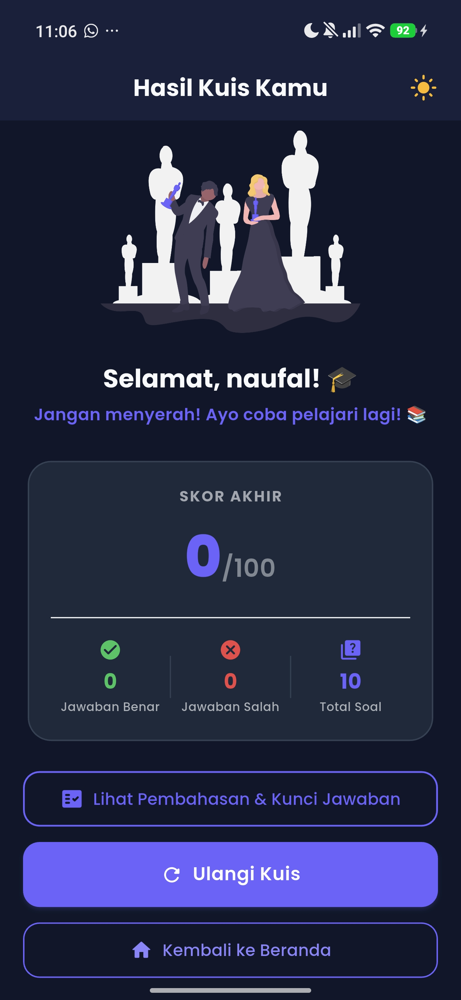

# Kuisiin — Aplikasi Kuis Pemrograman Mobile

Aplikasi kuis pilihan ganda interaktif berbasis Flutter yang dikembangkan bertahap untuk memenuhi tugas take-home UTS Pemrograman Mobile.

---

## Identitas Mahasiswa
| | |
|---|---|
| **Nama** | Muhammad Naufal Zuhdi |
| **NIM** | 241401052 |
| **Lab** | Pemrograman Mobile 1 |

---

## Informasi Aplikasi

| | |
|---|---|
| **Nama Aplikasi** | Kuisiin |
| **Platform** | Android, iOS, Web |
| **Bahasa / Framework** | Dart / Flutter |
| **Topik Kuis** | Pemrograman Mobile (Dart, Flutter, Konsep Mobile, Arsitektur Aplikasi) |

**Deskripsi:**
Kuisiin adalah aplikasi kuis interaktif yang menguji pemahaman mahasiswa tentang pemrograman mobile. Pengguna memasukkan nama, menjawab 10 pertanyaan pilihan ganda, dan mendapatkan evaluasi skor akhir secara instan. Aplikasi mendukung navigasi maju–mundur antar soal, persisten state saat rotasi layar, tampilan adaptif landscape, tema gelap/terang, dan peninjauan pembahasan jawaban lengkap.

---

## Daftar Fitur

### Fitur Wajib
| # | Fitur | Keterangan |
|---|---|---|
| 1 | **Input Nama Pengguna** | Validasi tidak boleh kosong, batas 30 karakter, trim spasi |
| 2 | **Kuis Pilihan Ganda** | 10 soal topik Pemrograman Mobile & Flutter |
| 3 | **Progress Bar Soal** | Indikator "Soal X dari Y" dengan `AnimatedLinearProgressIndicator` |
| 4 | **Navigasi Maju–Mundur** | Tombol Sebelumnya & Berikutnya, jawaban tersimpan saat balik |
| 5 | **Halaman Hasil Skor** | Skor /100, statistik benar/salah, pesan motivasi dinamis |
| 6 | **UI Responsif** | Semua dimensi dihitung via `Responsive` (persentase layar, tidak ada hardcode) |
| 7 | **Persistensi State Rotasi** | `QuizProvider` dengan `ChangeNotifier` + `MultiProvider` di atas `MaterialApp` |
| 8 | **Minimal 3 Halaman** | Welcome Screen, Quiz Screen, Result Screen |
| 9 | **Reusable Widgets** | `PrimaryButton`, `OptionTile`, `QuestionCard`, `QuizProgressBar`, `ScoreCard`, dll. |
| 10 | **Aset & Font Kustom** | Gambar ilustrasi (unDraw) + Font Poppins lokal |

### Fitur Bonus
| # | Fitur | Keterangan |
|---|---|---|
| B1 | **Dark & Light Mode** | Toggle animasi di setiap AppBar via `ThemeProvider` |
| B2 | **Tampilan Adaptif Landscape** | Tata letak 2-kolom otomatis saat orientasi landscape |
| B3 | **Review Jawaban & Pembahasan** | Modal bottom sheet menampilkan evaluasi benar/salah + kunci jawaban + penjelasan |

---

## Dokumentasi & Credit Aset

### Palet Warna (Design Tokens)
| Token | Hex | Keterangan |
|---|---|---|
| Primary | `#6C63FF` | Deep Purple / Indigo |
| Secondary | `#FF6584` | Coral Pink |
| Accent | `#FFB800` | Gold / Amber |
| Background Light | `#F8FAFC` | Latar terang |
| Background Dark | `#0F172A` | Latar gelap (navy slate) |
| Surface Light | `#FFFFFF` | Permukaan kartu terang |
| Surface Dark | `#1E293B` | Permukaan kartu gelap |

### Credit Sumber Aset
| Aset | Sumber | Lisensi |
|---|---|---|
| **Font Poppins** (Regular, Medium, SemiBold, Bold) | [Google Fonts — Indian Type Foundry / Jonny Pinhorn](https://fonts.google.com/specimen/Poppins) | SIL Open Font License 1.1 |
| **`assets/images/welcome_hero.png`** — Ilustrasi vektor Questions | [unDraw](https://undraw.co/) oleh Katerina Limpitsouni | Open-Source (bebas pakai) |
| **`assets/images/trophy_result.png`** — Ilustrasi vektor Awards & Trophy | [unDraw](https://undraw.co/) oleh Katerina Limpitsouni | Open-Source (bebas pakai) |
| **`assets/images/quiz_logo.png`** — Logo aplikasi Kuisiin | [unDraw](https://undraw.co/) oleh Katerina Limpitsouni | Open-Source (bebas pakai) |
| **`assets/icons/quiz_medal.png`** — Ikon medali penghargaan | [Flaticon](https://www.flaticon.com/) | Flaticon License |

---

## Screenshot Halaman

### Welcome Screen
| Portrait | Landscape |
| :---: | :---: |
|  |  |

### Quiz Screen
| Portrait | Landscape (2-kolom) |
| :---: | :---: |
|  |  |

### Result Screen
| Portrait | Landscape |
| :---: | :---: |
|  |  |

### Dark Mode
| Welcome Dark | Quiz Dark | Result Dark |
| :---: | :---: | :---: |
|  |  |  |


---

## Mockup / Prototype

- **Link Figma:** [Klik di sini untuk melihat prototype](https://www.figma.com/design/kTDQjTfIk0wASWRaLXVOac/Untitled?node-id=0-1&t=rffWSil8Hs9lS7zB-1)

---

## Video Presentasi

- **Link Video Google Drive:** [Klik di sini untuk menonton](https://drive.google.com/file/d/12c9tTp3RO9rzCs7QVkCkJ06u4zeTgRcm/view?usp=sharing)

---

## Cara Menjalankan Aplikasi

```bash
# 1. Clone repository
git clone https://github.com/nauflzuhd/Kuisiin.git
cd Kuisiin

# 2. Unduh package dan dependensi
flutter pub get

# 3. Jalankan aplikasi di emulator atau perangkat fisik
flutter run

# 4. (Opsional) Jalankan seluruh test suite
flutter test
```

> **Persyaratan:** Flutter SDK ≥ 3.x, Dart ≥ 3.x

---

## Struktur Proyek

```
lib/
├── core/
│   ├── constants/       # AppColors, AppStrings, AppRoutes
│   ├── theme/           # AppTheme (light & dark)
│   └── utils/           # Responsive helper
├── data/                # questions_data.dart (data dummy lokal)
├── models/              # Question model
├── providers/           # QuizProvider, ThemeProvider
├── screens/             # WelcomeScreen, QuizScreen, ResultScreen
└── widgets/             # PrimaryButton, OptionTile, QuestionCard,
                         # QuizProgressBar, ScoreCard, ThemeToggleButton,
                         # ReviewAnswersSheet
```

---

## Catatan Perkembangan Harian

- **Hari 1 (11 Okt 2026):** Setup repositori Git, inisialisasi Flutter, setup struktur folder modular (`core/`, `data/`, `models/`, `providers/`, `screens/`, `widgets/`), dan penambahan library `provider`.
- **Hari 2 (12 Okt 2026):**
  - Menentukan konsep tema kuis (Pemrograman Mobile).
  - Mengunduh font lokal Poppins (Regular, Medium, SemiBold, Bold) ke `assets/fonts/`.
  - Menyiapkan aset grafis resolusi tinggi di `assets/images/` dan `assets/icons/`.
  - Mendaftarkan aset dan font di `pubspec.yaml`.
  - Membuat konstanta warna `AppColors` (`lib/core/constants/app_colors.dart`) dan konstanta teks/aset `AppStrings` (`lib/core/constants/app_strings.dart`).
- **Hari 3 (13 Okt 2026):**
  - Membuat model data `Question` (`lib/models/question.dart`).
  - Menyiapkan data dummy kuis berisi 10 pertanyaan Pemrograman Mobile & Flutter dalam satu list (`lib/data/questions_data.dart`).
  - Membuat utility pembantu `Responsive` (`lib/core/utils/responsive.dart`) untuk kalkulasi dimensi dinamis.
  - Mengonfigurasi `AppTheme` (`lib/core/theme/app_theme.dart`) untuk light & dark theme dengan font kustom Poppins.
  - Memasang tema global dan integrasi ke `MaterialApp` (`lib/app.dart`).
- **Hari 4 (14 Okt 2026):**
  - Membuat komponen reusable `PrimaryButton` (`lib/widgets/primary_button.dart`) dengan dimensi dinamis dan handling status loading.
  - Membangun halaman `WelcomeScreen` (`lib/screens/welcome_screen.dart`) berbasis `StatefulWidget` dengan layout responsif terpusat.
  - Menerapkan validasi input nama (tidak boleh kosong, trim spasi, batas karakter) dan pesan error informatif.
  - Menggunakan `SingleChildScrollView` dan `keyboardDismissBehavior` untuk memastikan tampilan bebas overflow saat keyboard virtual aktif maupun saat layar dirotasi (landscape).
  - Mengintegrasikan `WelcomeScreen` ke dalam root `MaterialApp` (`lib/app.dart`).
- **Hari 5 (15 Okt 2026):**
  - Mengimplementasikan `QuizProvider` (`lib/providers/quiz_provider.dart`) berbasis `ChangeNotifier` untuk menyimpan state nama pengguna, index soal, jawaban terpilih, dan evaluasi skor.
  - Memasang `MultiProvider` dan `ChangeNotifierProvider` di atas root `MaterialApp` (`lib/main.dart`) agar state tetap persisten saat rotasi layar atau navigasi halaman.
  - Mendefinisikan konstanta rute `AppRoutes` (`lib/core/constants/app_routes.dart`) dan konfigurasi named routes di `lib/app.dart`.
  - Membuat halaman placeholder `QuizScreen` (`lib/screens/quiz_screen.dart`) dan `ResultScreen` (`lib/screens/result_screen.dart`).
  - Menghubungkan input nama di `WelcomeScreen` agar tersimpan langsung ke `QuizProvider` dan melakukan navigasi ke `QuizScreen`.
- **Hari 6 (16 Okt 2026):**
  - Membuat widget modular `OptionTile` (`lib/widgets/option_tile.dart`) dengan badge huruf (A-D), animasi transisi warna, dan indikator status terpilih.
  - Membuat widget modular `QuestionCard` (`lib/widgets/question_card.dart`) untuk menampilkan kategori topik kuis, nomor urut pertanyaan, dan teks soal responsif.
  - Membuat widget modular `QuizProgressBar` (`lib/widgets/quiz_progress_bar.dart`) dengan indikator teks "Soal X dari Y", persentase pengerjaan, dan visual animated `LinearProgressIndicator`.
  - Merakit tata letak utama `QuizScreen` (`lib/screens/quiz_screen.dart`) yang membaca data dinamis dari `QuizProvider`, menyertakan sapaan pengguna di header, serta tombol navigasi pertanyaan.
- **Hari 9 (19 Okt 2026):**
  - Menyempurnakan logika kuis di `QuizProvider` (`lib/providers/quiz_provider.dart`): persistensi jawaban saat navigasi maju/mundur, evaluasi skor otomatis, proteksi `PopScope`, dan dialog konfirmasi jika masih ada soal belum terjawab saat menekan "Selesai".
  - Membuat widget modular `ScoreCard` (`lib/widgets/score_card.dart`) untuk menampilkan nilai besar rasio /100 dan statistik rincian (benar, salah, total soal).
  - Menyelesaikan antarmuka lengkap `ResultScreen` (`lib/screens/result_screen.dart`) dengan sapaan personal, pesan motivasi dinamis sesuai persentase nilai, tombol "Ulangi Kuis", dan "Kembali ke Beranda".
  - Mengaudit seluruh stylesheet untuk memastikan ukuran dinamis berbasis `Responsive` (kriteria #6) dan mengimplementasikan tata letak adaptif 2 kolom saat layar berada pada orientasi landscape.
- **Hari 10 (20 Okt 2026):**
  - Mengimplementasikan fitur bonus tema ganda (Light & Dark Mode) menggunakan `ThemeProvider` (`lib/providers/theme_provider.dart`) dengan integrasi global pada `MaterialApp`.
  - Membuat widget reusable `ThemeToggleButton` (`lib/widgets/theme_toggle_button.dart`) dengan animasi rotasi/skala halus yang disematkan pada seluruh AppBar layar aplikasi.
  - Membangun fitur peninjauan dan pembahasan kuis lengkap (`ReviewAnswersSheet`) di halaman hasil (`lib/widgets/review_answers_sheet.dart`) untuk menampilkan evaluasi benar/salah setiap butir soal beserta kunci jawaban dan penjelasannya.
- **Hari 11 (21 Okt 2026):**
  - Melakukan audit komprehensif kode dengan `flutter analyze` untuk memastikan tidak ada warning maupun error lint (0 issues).
  - Memperbarui suite pengujian widget & unit test pada `test/widget_test.dart` (mencakup flow render halaman, validasi input nama kosong, logika kalkulasi skor kuis di `QuizProvider`, serta fungsi toggle `ThemeProvider`), dan seluruh pengujian berhasil lulus 100%.
  - Merapikan struktur dan format kode pada seluruh direktori `lib/` dan `test/` menggunakan perintah standar `dart format`.
- **Hari 12 (23 Okt 2026):**
  - Melengkapi dokumen `README.md`.
  - Menyiapkan folder `docs/screenshots/` untuk menyimpan screenshot aplikasi.
  - Merekam dan mengunggah video presentasi ke Google Drive.
  - Memperbarui `README.md` dengan link video presentasi final.
